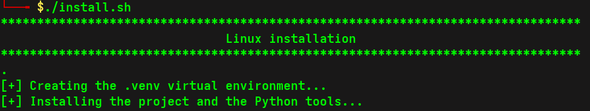
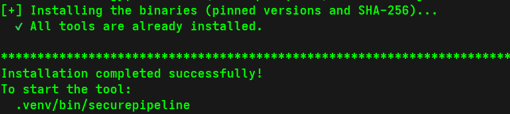

<h1 align="center">SecurePipeline</h1>

<p align="center">
  <strong>Multi-stack DevSecOps security scanner for your terminal and your CI.</strong>
</p>

<p align="center">
  Created by <a href="https://github.com/VISCHENZISCH"><strong>Félix TOVIGNAN</strong></a>
  ·
  <a href="https://github.com/VISCHENZISCH/SecurePipeline"><strong>VISCHENZISCH/SecurePipeline</strong></a>
</p>

<p align="center">
  <a href="https://github.com/VISCHENZISCH/SecurePipeline/stargazers"></a>
  <a href="https://github.com/VISCHENZISCH/SecurePipeline/commits/main"></a>
  
  <a href="SECURITY.md"></a>
  <a href="LICENSE"></a>
</p>

<p align="center">
  &nbsp;&nbsp;
  &nbsp;&nbsp;
  &nbsp;&nbsp;
  &nbsp;&nbsp;
  &nbsp;&nbsp;
  &nbsp;&nbsp;
  
</p>

SecurePipeline detects the technologies in a repository, runs the matching security tools in parallel, and clearly reports anything it could not verify.

## Features

- **Automatic detection**: Python, Node.js, PHP, Flutter, Docker and Kubernetes, with no configuration.
- **Fast by design**: tools run in parallel, Semgrep runs once for all stacks, and dependency folders are skipped.
- **Static analysis**: Semgrep and Bandit, plus bundled rules for JavaScript/TypeScript and PHP.
- **Dependency audit**: pip-audit, npm audit, composer audit and dart pub outdated.
- **Infrastructure audit**: Hadolint, Trivy, kube-score, Checkov and kubesec.
- **Secret detection**: Gitleaks runs on every project, and secrets are redacted from reports.
- **Reliable results**: a missing or failing tool makes the scan "incomplete" instead of declaring it clean.
- **Verified tools**: binaries use pinned versions and are checked against a SHA-256 before being installed.
- **CI/CD ready**: precise exit codes, readable logs, and Markdown, HTML and JSON reports.

## Supported stacks

|                                                                            | Stack            | Tools                                                                |
| -------------------------------------------------------------------------- | ---------------- | -------------------------------------------------------------------- |
|                                                                            | **All projects** | Gitleaks                                                             |
|      | **Python**       | pip-audit, Bandit, Semgrep                                           |
|   | **Node.js**      | npm audit, Semgrep with bundled rules                                |
|         | **PHP**          | composer audit, Semgrep with bundled rules                           |
|     | **Flutter**      | dart pub outdated (outdated dependencies only, no SAST or CVE audit) |
|      | **Docker**       | Hadolint, Trivy                                                      |
|  | **Kubernetes**   | kube-score, Checkov, kubesec                                         |

Runs on
 Linux,
 macOS and
 Windows.
See [platform notes](https://github.com/VISCHENZISCH/SecurePipeline/blob/main/docs/INSTALL.md#platforms) for the exceptions.

## Installation

Requires Python 3.11+ and Git.

### From PyPI

[pipx](https://pipx.pypa.io/) installs SecurePipeline in its own environment, which keeps the Python tools (Semgrep, Checkov) away from your other packages:

```bash
pipx install "securepipeline[tools]"
securepipeline tools install --yes --bin-dir ~/.local/bin
```

The second command downloads the binary tools (Gitleaks, Trivy, Hadolint...) at pinned versions and checks their SHA-256.

### Linux and macOS, from source

```bash
git clone https://github.com/VISCHENZISCH/SecurePipeline.git
cd SecurePipeline
chmod +x install.sh
./install.sh
```

### Windows (PowerShell), from source

```powershell
git clone https://github.com/VISCHENZISCH/SecurePipeline.git
cd SecurePipeline
.\install.ps1
```

If PowerShell blocks the script because of its execution policy, allow it for the current session only:

```powershell
Set-ExecutionPolicy -Scope Process -ExecutionPolicy Bypass
.\install.ps1
```

<p align="center">
  
</p>

<p align="center">
  
</p>

The script creates `.venv`, then installs the project and its tools. `npm`, `composer` and `dart` are installed separately if you need them. Details: [docs/INSTALL.md](https://github.com/VISCHENZISCH/SecurePipeline/blob/main/docs/INSTALL.md).

## Usage

### Interactive menu

On Linux and macOS:

```bash
.venv/bin/securepipeline
```

On Windows, the path uses `Scripts` instead of `bin`:

```powershell
.\.venv\Scripts\securepipeline.exe
```

The menu displays the current project, its stacks, the missing tools and the last scan summary. Press `1` to scan the current project, or `2` to scan another one right away.

### Scan progress

Each tool shows its live status, and a check mark as soon as it has run. The scan ends with a clear verdict and the number of findings per severity.

### Commands

Examples below assume that `.venv` is activated.

```bash
securepipeline scan                        # Scan the current directory
securepipeline scan /path --fail-on high   # Fail from "high" severity
securepipeline scan . --format both        # Markdown and HTML reports
securepipeline detect                      # Show stacks and planned tools
securepipeline tools check                 # Show tool status
securepipeline tools install               # Install the missing tools
```

### Exit codes

| Code | Meaning                                           |
| ---- | ------------------------------------------------- |
| `0`  | No finding at the threshold and a complete scan   |
| `1`  | At least one finding at the `--fail-on` threshold |
| `2`  | Incomplete scan (tool missing or failed) or error |

Reports are written to `.securepipeline/reports/`. Full guide: [docs/USAGE.md](https://github.com/VISCHENZISCH/SecurePipeline/blob/main/docs/USAGE.md).

> [!WARNING]
> Do not commit the `.securepipeline/` folder. The reports list the weaknesses of your project, with file paths and line numbers, and anyone who can read the repository could use them. Add it to your `.gitignore` before your next commit:
>
> ```bash
> echo ".securepipeline/" >> .gitignore
> ```
>
> If it is already committed, remove it from Git but keep your local copy with `git rm -r --cached .securepipeline`, then commit.

### Docker

```bash
docker build -t securepipeline:latest .
docker compose run --rm scanner
```

With rootless Docker: `env UID=0 GID=0 docker compose run --rm scanner`.

###  GitHub Actions

The workflow in [.github/workflows/securepipeline.yml](https://github.com/VISCHENZISCH/SecurePipeline/blob/main/.github/workflows/securepipeline.yml) runs the tests, scans the repository, uploads the reports and comments on pull requests.

## Development

```bash
pip install -e ".[dev,tools]"
pytest
ruff check .
```

## Security

To report a vulnerability, please follow the [security policy](https://github.com/VISCHENZISCH/SecurePipeline/blob/main/SECURITY.md). DevSecOps recommendations are in [docs/DEVSECOPS.md](https://github.com/VISCHENZISCH/SecurePipeline/blob/main/docs/DEVSECOPS.md).

## License

Released under the [MIT License](https://github.com/VISCHENZISCH/SecurePipeline/blob/main/LICENSE).

## Author

 **Félix TOVIGNAN**, [@VISCHENZISCH](https://github.com/VISCHENZISCH)

If SecurePipeline helps you, [star the repository](https://github.com/VISCHENZISCH/SecurePipeline).

Logos are trademarks of their respective owners. Most come from [Simple Icons](https://simpleicons.org/).
